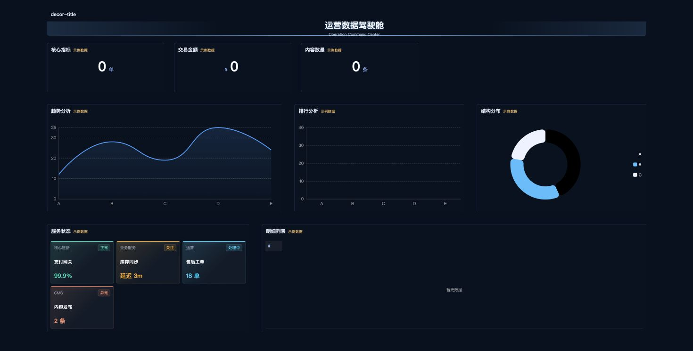
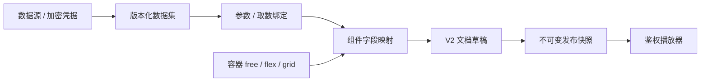

# Board Studio · SaiAdmin 6 大屏插件

[](https://github.com/guozhijian611/saiadmin-boardstudio/actions/workflows/ci.yml)
[](https://github.com/guozhijian611/saiadmin-boardstudio/releases)
[](LICENSE)

一个可单独安装到 **SaiAdmin 6.x** 的可视化大屏插件。将文档、布局、组件、数据源、数据集和发布权限分别管理，面向业务看板、运营驾驶舱和数据展示。



> 本仓库是插件源码，不是完整后台系统。先准备 SaiAdmin 宿主，再安装插件。截图使用预设示例数据。

## 能做什么

- **主题与语言**：后台控件跟随宿主明暗主题和主色，复用宿主中英文 locale；播放器链接携带界面语言。用户画布配色、标题和业务内容独立保留。
- **布局与编辑**：嵌套自由布局 / Flex / Grid、结构树、拖动缩放、框选与多选、对齐等距、复制、锁定、原子撤销/重做。
- **组件与预设**：图表、指标、表格和装饰组件；内置只读预设，支持筛选、整屏套用和组件组插入；JSON 导入/导出。
- **数据分层**：数据源保管连接；版本化数据集定义查询；组件通过绑定实例和字段映射使用结果。支持 MySQL 只读参数 SQL、同源可视化关联与 HTTP GET/POST。
- **运行调度**：参数联动、共享取数、每屏最多 4 个并发、隐藏暂停、失败退避、过期结果提示、服务端缓存及请求合并。
- **发布与权限**：不可变发布快照、历史切换、公开 / 登录授权 / 访问令牌；数据源与数据集授权、观看者用户/部门行级范围、凭据加密与接口脱敏。
- **安装保护**：Phinx 迁移、升级保留原数据、非空卸载保护；与原 `saiboard` 使用不同命名空间。



## 安装

1. 在 [Releases](https://github.com/guozhijian611/saiadmin-boardstudio/releases) 下载 **`boardstudio-版本号.zip`** 和 `SHA256SUMS.txt`。GitHub 自动生成的 “Source code” 压缩包不是可直接导入的插件包。
2. 在 SaiAdmin 的插件管理中上传 ZIP 并安装。
3. 根据宿主提示安装前端依赖。在宿主 `saiadmin-artd/src/main.ts` 增加一次语言注册导入（放在应用挂载前），再重新构建管理端：

   ```ts
   import './views/plugin/boardstudio/i18n/host'
   ```

   宿主 6.1.5 的语言按钮默认会重建页面。为避免插件表单丢失，推荐直接运行随包提供的接入脚本，它会同时补齐上述导入和插件路由的刷新保护：

   ```sh
   # 在 SaiAdmin server 目录执行；先省略 --apply 查看变更
   python3 plugin/boardstudio/bin/integrate-frontend.py --frontend ../saiadmin-artd --apply
   ```

   脚本保留原文件备份并可重复执行；不识别的宿主实现会拒绝修改，需按差异人工接入。该文件随 ZIP 提供，只合并 `boardstudio` 与 `menus.boardstudio` 命名空间，不覆盖宿主词条。宿主没有自动插件语言发现机制，菜单翻译需要此入口；页面本身仍会自动注册。出现 **Board Studio** 菜单后进入大屏管理。
4. 新建大屏 → V2 设计器 → 套用预设或添加组件 → 保存 → 发布与访问。

```sh
# Linux
sha256sum -c SHA256SUMS.txt
# macOS
shasum -a 256 -c SHA256SUMS.txt
```

校验文件同时列出安装包和独立源码包；请下载两个 ZIP 后运行上述命令，或仅校验已下载的对应行。

**验证基线**：SaiAdmin 6.1.5、saipackage 6.1.0、PHP 8.4、Vue 3 / Element Plus；宿主存储 MySQL 8.4 与 PostgreSQL 17。其它 6.x 小版本需要自行回归。PostgreSQL 宿主支持不代表 PostgreSQL 业务数据源连接器。

升级前备份数据库、插件文件及凭据密钥。旧大屏显式转换为 V2，不在安装时覆盖。存在业务数据时卸载会拒绝；不要为了卸载直接删除业务表。

## 数据与刷新如何配置

**添加数据源 → 创建数据集 → 预览字段 → 保存版本 → 组件绑定 → 发布**。

数据集不是数据库连接本身：同一个数据源可以定义多个参数化查询。可以手写受限 `SELECT`，也可选择表、关联、筛选、分组和聚合；HTTP 在后端执行，可提取响应中的数组。SQL 使用专用只读数据库账号，查询权限不等于连接管理权限。

数据集默认轮询间隔 30 秒，可设 10–3600 秒；组件绑定可覆盖或只手动刷新。**缓存时间、轮询间隔、页面参数、图表动画是独立设置**，不会定时刷新整个浏览器页面。单次最多 5000 行 / 2 MiB / 100–10000ms。失败保留同查询上次成功值并标记过期，参数改变或权限失效会清空旧结果。

主题与多语言的宿主接入及截图见 [适配说明](docs/theme-i18n.md)。完整安装、备份、凭据与 API 说明见 [插件手册](server/plugin/boardstudio/README.md)。

## 本地开发

工具链：Node.js 24、pnpm 10.33.0、Python 3.10+、PHP 8.4（含 OpenSSL）。以下命令均在本仓库根目录执行：

```sh
pnpm --dir saiadmin-artd install --frozen-lockfile
node tools/boardstudio/verify.mjs
node tools/boardstudio/build-player.mjs
python3 tools/boardstudio/package.py \
  --skip-build \
  --output dist/boardstudio-2.1.0.zip \
  --source-output dist/boardstudio-source-2.1.0.zip
python3 tools/boardstudio/check-package.py dist/boardstudio-2.1.0.zip
```

`verify.mjs` 运行核心 TypeScript 测试、PHP 纯逻辑测试及插件 ESLint；CI 另外对所有 PHP 文件做语法检查。独立构建仅生成播放器，管理端的 `@/utils/http`、用户状态和路由由宿主提供；本仓库不包含可独立启动的完整管理后台，也不将宿主类型检查冒充为插件单测。

```text
server/plugin/boardstudio/                  后端、迁移、播放器构建输出
saiadmin-artd/src/views/plugin/boardstudio/ 管理界面、共享文档模型、播放器入口
tools/boardstudio/                          校验、构建、打包及集成测试脚本
docs/                                      架构、发布与验收文档
VERSION                                    唯一发行版本号
```

在准备好的独立 SaiAdmin 6 环境中，通过生成的 ZIP 安装进行联调。HTTP/安装测试脚本用 `--help` 查看显式参数；`--disposable-fixture` 脚本只能针对可销毁测试库运行。不要向生产环境注入测试数据。[既有双库与浏览器验收记录](docs/boardstudio-v2.md)与 [持续集成范围](docs/releases.md)分别记录，CI 绿灯不代表自动完成所有浏览器/数据库验收。

## 自动打包与发布

- 提交到 `main`、提交 PR 或手动运行 **CI**：测试、构建并上传 ZIP / 源码包 / SHA256 构建产物。
- 修改 `VERSION` 并提交，推送匹配的 `vX.Y.Z` 标签：相同检查通过后，由 **Release** 创建 GitHub Release 并上传三个文件。
- 预发行版本如 `2.1.0-beta.1` 自动标记为 prerelease。标签不匹配 VERSION 时发布失败；已有 Release 不会被静默覆盖。

```sh
# 先修改 VERSION 并提交
# 以下版本号仅为示例，不要重复使用已有标签
git tag v2.2.0
git push origin main
git push origin v2.2.0
```

## 边界

不提供在线模板市场、任意 SQL 方言、跨数据库关联、任意用户脚本、HTTP 自动分页、在线密钥轮换或多人实时协作。HTTP 暂不支持观看者身份行级模式。生产规模与长时间稳定性需按部署负载继续测试。

## 参与与许可

欢迎通过 [Issues](https://github.com/guozhijian611/saiadmin-boardstudio/issues) 反馈问题或提交 PR，请参考 [贡献指南](CONTRIBUTING.md)；敏感漏洞使用 [安全报告说明](SECURITY.md)。

基于 [B8AIAdmin](https://github.com/guozhijian611/B8AIAdmin) 拆分与重构，感谢 SaiAdmin、Webman、Art Design Pro、Vue、Element Plus 和 ECharts。本项目使用 [MIT](LICENSE)；保留上游版权和依赖许可，详见 [第三方声明](THIRD_PARTY_NOTICES.md)。
