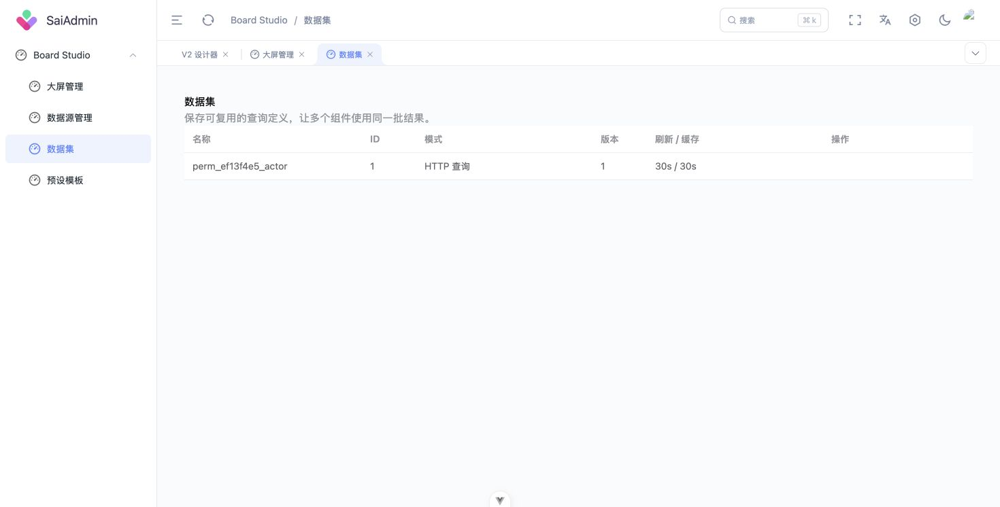
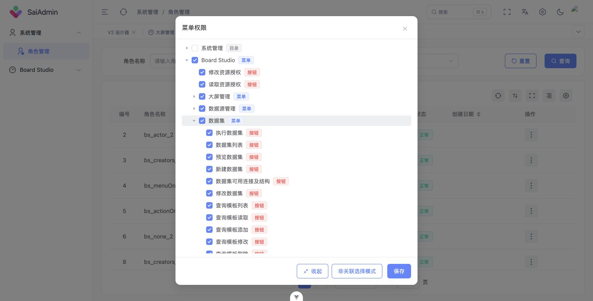
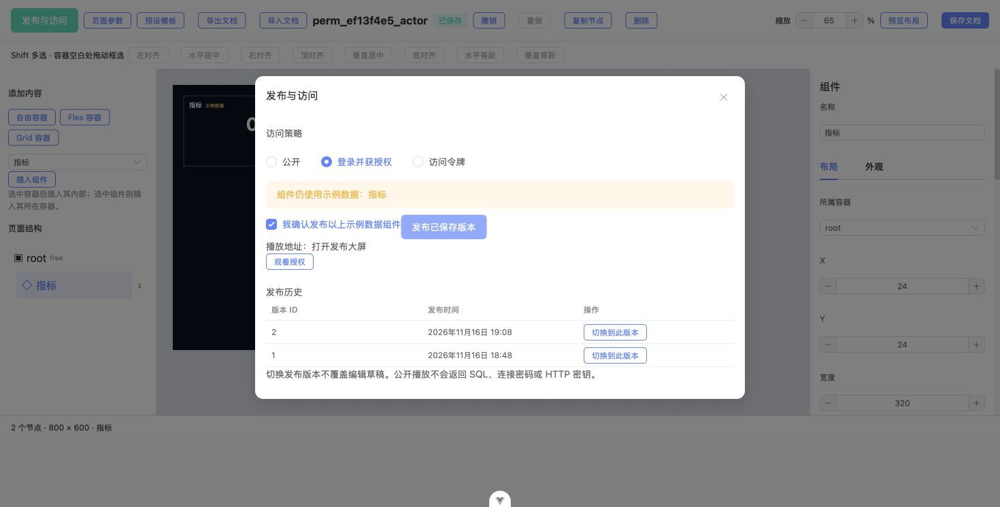

# 系统与数据权限（2.2.0）

## 三层后台权限与独立的发布策略

1. 认证与功能权限：沿用系统账号、角色、菜单、UserAuthCache 和 Permission 声明；40 个稳定权限点覆盖 50 个实际后台动作。RequirePermission 默认拒绝没有权限声明的接口，并返回 JSON 401/403；不更改核心 CheckAuth。
2. 角色数据范围：Screen、Document、旧查询模板、Datasource、Dataset 后台路径使用系统 data_scope 与角色/部门关系。列表、分页总数、全量导出基础查询、详情、锁定写入、混合 ID 批次、历史/令牌/发布子资源均先校验范围。没有后台文件导出接口的资源不虚构导出能力。
3. 资源授权：连接和数据集继续叠加 owner/user/role 授权；所有者及显式管理者也必须满足后台角色范围。部门主管有权管理部门大屏，不等于可以直接读取同部门他人的连接或查询定义。

发布大屏继续使用 public/login/token。登录观看还需 screen view/manage 授权；观看不授予草稿管理。后台角色“全部”不自动获得他人的登录播放权限。数据请求每次在读取缓存前检查资源/版本/账号与授权；已停用账号或角色不能通过旧会话继续取得资源授权。

外部 SQL/HTTP 返回的业务数据与后台记录范围不同。SQL viewer 策略通过服务器账号/部门在聚合前筛选；shared 结果适用于已明确授权的共享数据。HTTP 的业务行隔离由上游实施，不把 created_by 过滤冒充业务库或租户隔离。

## 与给定官方 DataScope 的接入

RoleDataScope 在插件命名空间内读取系统 sa_system_user/role/user_role/role_dept/dept，不覆盖核心或角色界面；已有官方角色数据权限入口可直接复用。安装检查所需系统表/字段，若宿主暴露范围常量则校验枚举契约。基线未包含 DataScope BaseLogic 方法时，同样由本插件的受测适配落实过滤。

| 值 | 范围 | 创建者筛选 |
|---|---|---|
| 1 | 全部 | 该层不限制记录；资源授权仍有效 |
| 2 | 自定义部门 | 所选角色的部门下用户创建的记录 |
| 3 | 本部门 | 当前用户部门下用户创建的记录 |
| 4 | 本部门与子部门 | 按实际父部门关系遍历，并防止循环 |
| 5 | 本人 | 当前有效账号 ID |

多角色沿用给定包的数值最大优先级，多个相同自定义范围固定取最小角色 ID，不做并集扩大范围。无有效角色、无效范围拒绝；无有效部门、空自定义部门返回空。超级管理员豁免沿用宿主 CheckAuth 的服务端 ID=1 规则，仍检查账号有效。

每次读取真实范围输入，不依赖旧 UserInfoCache 中的角色范围、不保留实例级用户 ID 数组；部门调动与范围变更在下次请求生效。created_by 为服务器身份且普通更新不可改写。升级不把未知历史行归给安装者，现有记录归属保留；四张主表增加插件自有归属索引。

**升级行为变化**：旧版后台大屏主要按“ID=1 全部，其余仅本人”；2.2.0 开始遵循角色 data_scope，原值 1 即可访问全部大屏。安装器不会擅自把全部角色改成 5，部署者应在正常角色管理流程中核对范围。参考包 README/旧数据库字段注释可能存在差异，本版明确使用上述给定 DataScope 契约。

给定包 SHA256 为 6b2ae4caac60404d5878bfa8505b45ae59884455c43232a641d46eea85cb0ae6。其空角色默认全部、userIds 实例累积和按钮权限码不一致没有被复制进插件。未将覆盖包或固定菜单 ID SQL 加入发行包。

## 权限点与旧版授权迁移

大屏管理沿用 boardstudio:screen:*；旧查询模板的 API 继续使用 boardstudio:query_template:*；连接沿用 boardstudio:datasource:*。完整声明见 PermissionCatalog.php，菜单父节点按稳定 code 查找，不硬编码菜单/角色 ID。

| 新权限 | 旧权限来源 | 行为 |
|---|---|---|
| boardstudio:dataset:index | query_template:index | 可用数据集列表 |
| boardstudio:dataset:save | query_template:save | 新建，不接受已有 ID |
| boardstudio:dataset:update | query_template:save | 更新并创建版本；原 V2 更新同样使用 save 权限 |
| boardstudio:dataset:preview | query_template:preview | 预览未保存定义 |
| boardstudio:dataset:execute | query_template:preview | 执行已保存数据集 |
| boardstudio:dataset:sources | datasource:index | 有权使用的连接及结构，不返回凭据 |
| boardstudio:resource:grants/grant | query_template:update | 读取/修改资源授权，另检查该资源 manage 权限 |

表中旧权限也有 boardstudio: 前缀。首次注册新权限时只复制原先持有对应权限的角色关系，不给所有角色授权；已有权限点保留 ID 和关系，用户自定义名称保留。重复接入不重新授予后来被管理员撤销的权限。隐藏编辑器路由沿用已有设计授权，已知默认排序下沉，避免插件专用角色登录到 designer/:id 占位路径。

数据集 API：新建为 POST /app/boardstudio/admin/Dataset/save；更新为 POST /app/boardstudio/admin/Dataset/update。新建入口拒绝传已有 ID 更新，修改入口独立检查 update 权限。Document/activate 与恢复权限 boardstudio:screen:restoreVersion 对齐。

菜单迁移、按钮/菜单/反射缓存失效随第十个迁移自动完成，不要求运行接入脚本。卸载先检查全部业务表，拒绝时不清理授权；允许后仅删除插件自己的菜单关系、新节点和自动接入，不删除系统角色、部门或共享 core:role:data。

2.2.0 的自动接入在原 main.ts/语言刷新保护之外，增加系统 role/modules/permission-dialog.vue 的最小标签片段：使用宿主 formatMenuTitle 展示树节点，避免授权界面原样显示菜单语言键。通过独立标记/别名管理导入与表达式；三文件先完整预检、备份并原子写入，失败回退，卸载保留用户其它修改。第十个迁移会为已运行旧第九个迁移的安装补上新片段；已原生适配的宿主不重复修改，不支持结构明确失败。

PostgreSQL 实测发现基线 SystemRoleLogic::saveMenuPermission 的 insertAll 生成 INSERT ... SELECT ... UNION，参数被推断为 text，保存 bigint menu_id 失败。PG 安装在同一文件接入计划中增加第四个目标，将已核对的这一条语句改为同一原事务内逐行 insert（VALUES），保留原路由、鉴权、事务边界与缓存处理。不是替换整个核心或改写全局 ORM。片段带管理标记、备份及一致性检查；第四个文件写入失败会恢复前三个文件，卸载准确恢复原语句并保留其它用户改动。已原生采用相同安全插入实现时不重复接管，未知实现拒绝安装。本兼容只覆盖实际验证的菜单授权问题，不宣称修复宿主全部 PostgreSQL API。

## 前端与运行问题修复

- 使用宿主响应式 getUserInfo.buttons，支持 * 超级管理员标记。采用 v-if 检查，修复 Element Plus 下拉组件非单根节点导致 v-permission 无效，以及动态弹窗按钮被永久移除的问题。
- 数据集新建/修改、资源授权、发布、恢复及令牌动作各自检查功能权限；资源授权还使用当前记录的 manage 结果。只读列表不自动请求连接结构，发布面板不自动请求未获准的历史/令牌列表。
- 新权限名称与新增提示覆盖宿主中英文；主题与语言继续通过原自动入口接入。
- 基线 CheckAuth 拒绝请求会在 PHP 8.4 触发 SystemException 隐式 nullable 的弃用异常，表现为非 JSON 500。插件复用系统权限缓存自行严格鉴权，稳定返回 JSON 403，没有抑制错误或修改核心。
- 普通更新不能写入 created_by、V2 草稿或发布指针；复制保持未发布，跨所有者复制移除数据绑定。

## 可重复验证

纯逻辑/权限注册与翻译校验包含在 node tools/boardstudio/verify.mjs。真实 HTTP 矩阵使用本仓库工具，路径由调用者提供：

```sh
python3 tools/boardstudio/tests/permissions_http.py \
  --lab /absolute/path/to/sai6lab-EXAMPLE \
  --lab-script /absolute/path/to/saiadmin6-plugin/scripts/lab.py \
  --disposable-fixture
```

实验室须已通过真实 ZIP 安装并完成前端依赖安装，核心账号/token 文件由 prepare_lab.py 为本地一次性环境创建。测试只接受 lab.json 匹配的 sai6lab 项目及 localhost 后端，创建合成部门/账号/资源，私有测试令牌与密码仅保存在该实验室。HTTP 结果经实际认证/权限中间件；CLI 仅为实例复用等检查提供局部身份替身，不修改 Web 请求认证。

升级测试可先在旧版运行 --setup-only，安装新版后使用 --existing；空库卸载/重装后可用 --reseed 复用追踪的测试账号重新造数。fixture 会保留测试记录，清理仅使用对应一次性环境，不对其它数据库执行。

## 2.2.0 实际验收（2026-11-16）

使用真实 ZIP 导入两个全新、独立的 Docker 项目，另保留一个 MySQL 浏览器验收项目。基线为 SaiAdmin 6.1.5 / saipackage 6.1.0、PHP 8.4.27、MySQL 8.4 与 PostgreSQL 17；数据库镜像在本机 ARM 上以 amd64 模拟运行，本次不作性能结论。测试副本沿用了前期已修复的 saipackage 安装锁、迁移和重载处理，并非未经修改的官方安装器。

| 验收项 | MySQL | PostgreSQL |
|---|---|---|
| 最终 ZIP 全新导入、10 个迁移、40 个唯一权限点、安装状态 1 | 通过 | 通过 |
| 真实前端依赖安装、Vite 构建、vue-tsc | 通过 | 通过 |
| 50 个实际后台动作拒绝仅菜单账号；匿名及无权限账号拒绝 | 通过 | 通过 |
| 五种范围下四类资源列表/总数/详情/连接选择器一致 | 通过 | 通过 |
| 越权子资源、伪造归属与发布字段、混合 ID 删除原子性 | 通过 | 通过 |
| 连接/数据集授权交集、撤权后的热缓存、停用角色的观看授权 | 通过 | 通过 |
| 核心角色菜单 API 保存、同会话撤销权限、重复接入不重新授权 | 通过 | 通过 |
| 有数据拒绝卸载；空库卸载/重装；保留宿主自定义修改 | 通过 | 通过 |
| 不支持宿主结构失败且不半接入，修复后继续安装 | 通过 | 通过 |
| 公开 2.1.1 ZIP 升级保留归属、业务数据与原有授权映射 | 通过 | 通过 |

PostgreSQL 额外检查失败安装不遗留 idle-in-transaction 连接，以及第四个后端管理片段的安装、卸载还原。纯测试覆盖第三/第四个文件写入失败的回退、LF/CRLF、管理片段被修改时的拒绝与用户其它编辑的保留。

浏览器以正常登录的合成普通账号验证：本人范围仅返回自己的大屏与数据集；只读数据集没有新建/编辑/授权按钮；恢复功能权限后，HTTP 预览返回数值 42，保存生成第 2 版；V2 插入组件、保存及发布生成第 2 个发布版本。系统角色授权树能显示“新建数据集”“修改数据集”等中文名称。本轮未重跑全部主题色与英文切换组合，双语键覆盖由自动校验检查；此前主题验收见 [主题与多语言](theme-i18n.md)。核心基线没有官方数据范围配置弹窗，本轮通过实际角色更新 API 与合成部门关系配置并验证五种范围。







测试基础设施同时修正了 PostgreSQL 初始化阶段仅 socket 就绪而 TCP 尚不可用，以及核心安装延迟重载中断首次插件迁移的等待顺序。一次性环境关闭开发文件监视器，但保留安装器实际重载；没有以手工复制插件替代 ZIP 导入。

本地完整验收的安装 ZIP SHA256：`3ec57d6d89f419cfeefe2b46d99922af89ddb8f64142cb9037d9bcfcd5c3a711`。GitHub Release 重新构建并附 SHA256SUMS.txt，以该文件校验下载资产；源码 ZIP 包含本报告和可重复测试工具。

为区分基线提交与实际运行副本，安装前宿主文件 SHA256 如下（相对 server）：

| 文件 | SHA256 |
|---|---|
| composer.lock | e26d5573c6383321e1fcdcc70aa8a5c18bd81167cf7b330b4c3c3d549805bfaf |
| plugin/saipackage/app/logic/InstallLogic.php | 8e12e0b334b270fec0148070fbba37f6b9a0e723252fc4ee9f3f4304152beec8 |
| plugin/saipackage/app/logic/PluginMigrator.php | 9bf950eac54edcea2514c267cf06ba3de0e9cfa9ccfbc166e040ce5fed623ddc |
| plugin/saiadmin/app/logic/system/SystemRoleLogic.php | b838000725ec4e12f96a73242c09d1729f0b677164481af271625ad6f5e7f4dd |

可重复执行生命周期与旧版升级：

```sh
python3 tools/boardstudio/tests/auto_integration_http.py \
  --lab /absolute/path/to/sai6lab-EXAMPLE \
  --lab-script /absolute/path/to/saiadmin6-plugin/scripts/lab.py \
  --zip /absolute/path/to/boardstudio-2.2.0.zip \
  --old-zip /absolute/path/to/boardstudio-2.1.1.zip \
  --permissions --disposable-fixture
```

此命令会销毁目标一次性实验室中的插件数据，不用于已有业务环境。完整宿主、密码和令牌不进入源码/安装包；本次发布不等于生产部署或 SaiStore 提审，也不宣称完成宿主全局 RBAC 审计。
