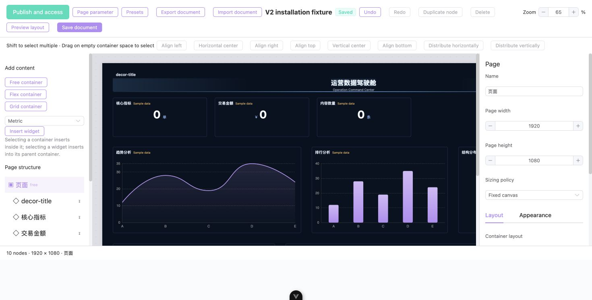
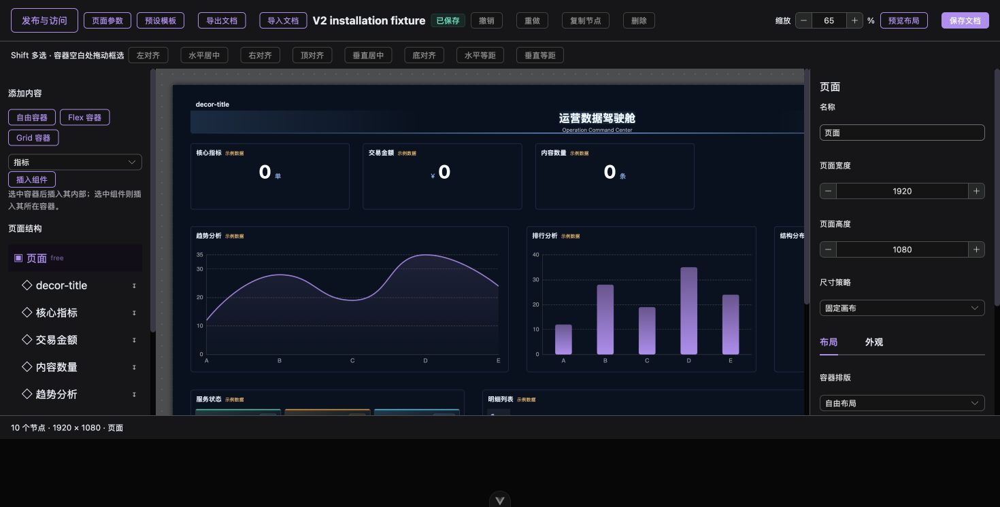

# 主题与语言适配（2.1.0）

## 宿主契约

本轮验证使用官方 SaiAdmin 6.1.5 / saipackage 6.1.0。宿主以 `src/locales/index.ts` 的 vue-i18n Composer 管理 `zh` / `en`，以 `--el-*` 语义变量、根 `dark` 类和设置面板管理主题与主色。

插件注册仅合并 `boardstudio` 与 `menus.boardstudio`，不修改宿主默认语言、fallback 或已有词条；没有第二套后台语言状态。翻译目录、注册入口及适配代码均位于安装器允许的插件路径。新增自定义宿主语言时须补对应资源；本版验证范围为中英文。

## 必要接入

安装 ZIP 并完成前端依赖后，在宿主 server 目录运行：

```sh
# 默认只展示 diff；审阅后加 --apply
python3 plugin/boardstudio/bin/integrate-frontend.py --frontend ../saiadmin-artd --apply
```

脚本完成两项修改：

1. 在宿主 `src/main.ts` 导入插件的 `i18n/host`，使首次加载菜单时已有翻译。
2. 宿主 6.1.5 的 `changeLanguage` 在修改 locale 后会 `reload(50)` 重建页面。脚本仅让 `/boardstudio/` 路由跳过该重建，保留 locale 更新、语言持久化及其他宿主页面的原行为，避免插件未保存输入被清空。

原文件备份为 `*.boardstudio.bak`。脚本幂等，不识别的宿主结构拒绝修改；此时按 diff 人工适配，不应绕过检查或替换整个宿主文件。完成后重新构建管理端。插件页面可自行注册翻译，但导航初次加载及无损语言切换需要上述显式接入。

## 适配边界

- 工具栏、属性面板、表格、表单、弹窗、选择框与控件状态使用宿主语义主题变量。
- 组件标签、字段说明、默认提示、校验、确认框、空态和发布检查接入翻译；数据值、用户标题、字段别名、预设画布内容不作为 UI 词条重写。
- 图表空态随语言更新；图表以实际画布背景判断明暗，监听主题及画布祖先样式变化，不再强制固定深色。用户保存的背景、品牌色与系列配置保持原值。
- 运行状态的数字遵循界面 locale；版本列表时间在展示时本地化，不更改服务器存储值。
- 独立播放器使用链接中的 `lang` 与 `theme` 初始化自己的控件与 Element Plus locale；这不改写发布文档。直接打开无参数链接时默认中文。

## 验收

最终候选安装 ZIP SHA256：`bc00d9251930694b00ee7cb6e58f45d98664cc37ccf525857e0f30c80e228af7`。安装包字节以 GitHub Release 的 SHA256SUMS 为最终校验。

- 30 项 TypeScript 核心/本地化测试通过；另有 PHP 校验、插件 ESLint、宿主接入脚本的预览/幂等/拒绝未知结构测试。
- 两种 locale 资源不互相串状态；带变量文案及 JSON 示例正确；所有发行 Vue 模板均可编译，无未接入翻译的静态中文 UI。
- PostgreSQL 独立干净宿主从真实 ZIP 首装、实际依赖安装、八个迁移、管理端生产构建及完整 vue-tsc 通过。
- 最终同一 ZIP 从 2.0.0 升级，原屏记录逐字段不变；同版本导入拒绝、非空卸载保护和不可变发布通过。
- Chrome 在真实 ZIP 安装的干净宿主验证：中文/英文切换、菜单、数据集表单、预设名称和分类检索、发布警告、时间格式、英文独立播放器；浅色/深色与紫色主色。
- 修复宿主语言重建后，输入 `final-preserve-输入` 在切换语言后保持原值。导出文档仍保留原标题和 `#07111f` 画布背景；英文播放器继续展示用户/预设业务内容。





CI 仅验证单测、语法、构建和 ZIP，不把它当作数据库或浏览器验收的替代。其它宿主版本、自定义语言及主题扩展须按其实际实现回归。
